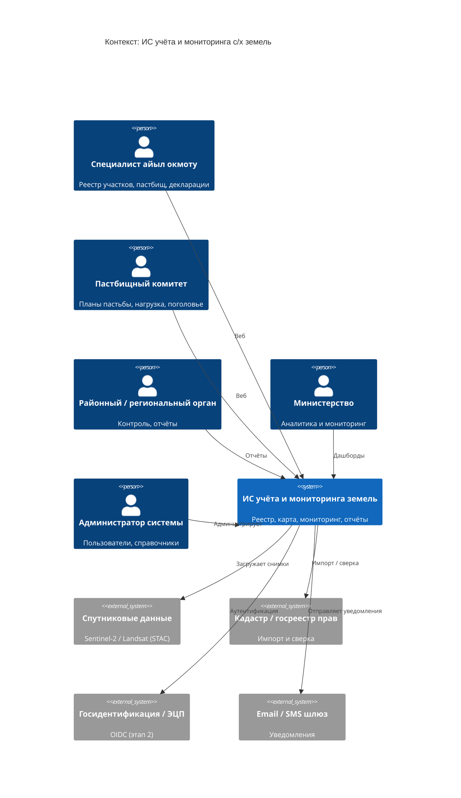
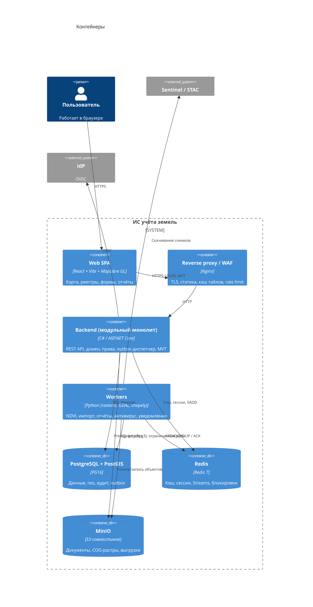
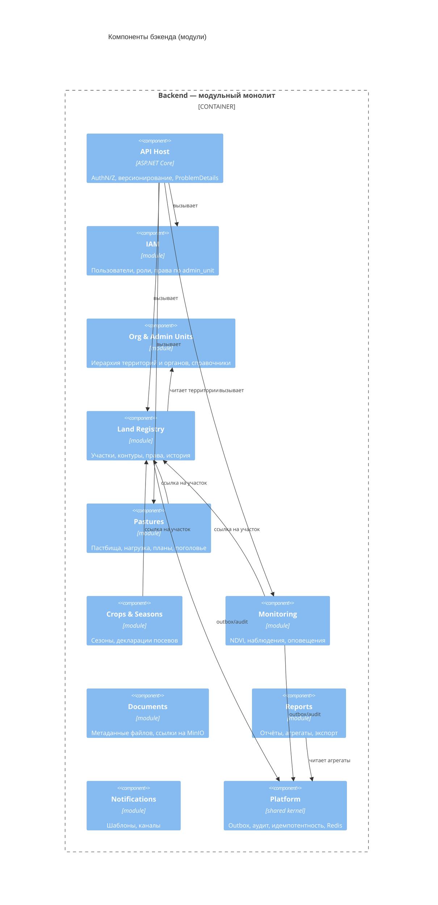

# C4-диаграммы

На этих схемах показаны пользователи системы, её основные части и модули Backend. Пояснения есть в [`../c4-guide.md`](../c4-guide.md).

## Контекст системы

## Части системы

## Модули Backend

